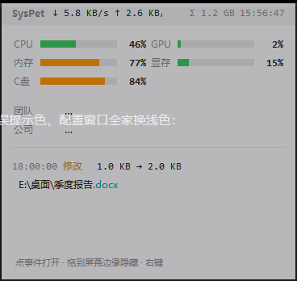
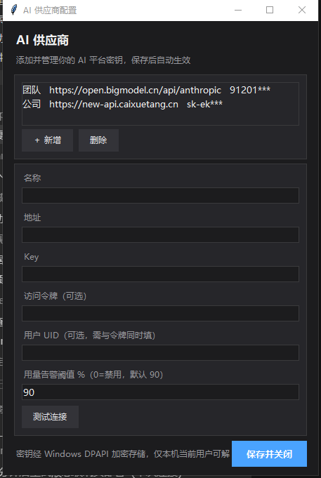

# SysPet — 桌宠式系统监控悬浮窗

[](LICENSE)
[]()
[]()

Windows 桌面常驻小工具：深色半透明悬浮窗（TrafficMonitor 风格），一个窗口看尽 **系统仪表 + 全盘文件变化 + 系统通知 + AI 平台用量**。单文件绿色版，免安装。




## 功能

### 系统仪表
CPU / 内存 / C盘 / GPU / 显存 / **GPU 温度**（圆角进度条，随负载绿→黄→红变色）；**点击磁盘仪表循环切换盘符**（C/D/E…）；标题带实时显示上/下行网速、**今日累计流量（Σ，点击看最近 3 天历史）**与时钟。**点击 CPU / 内存仪表弹出当前 Top 5 进程**，一眼看到谁在吃资源。GPU 读数来自 `nvidia-smi`（无 N 卡时显示 `—`）。

### 智能告警
- **AI 用量**：已用百分比越过阈值（默认 90%，配置窗口可调，0 禁用）→ 事件流红色条目
- **系统指标**：CPU > 90% 或磁盘 > 95% → 同样入事件流（滞回去抖，回落自动重新武装）
- 告警同时**弹 Windows 原生通知**，全屏工作时也能看到

### 全盘文件监控
基于 Windows 内核通知（`ReadDirectoryChangesW`），**所有本地盘 + 热插拔 U 盘**实时捕获新增 / 修改 / 删除 / 改名，含修改前后大小快照；内核洪峰时被拆开的改名事件自动跨批配对。滚轮翻看最近 200 条，**单击直接打开文件、右键选择打开方式 / 资源管理器定位**。

### 系统通知捕获
其他软件弹出的 Windows Toast 通知（微信、钉钉、邮件等）实时并入事件流（紫色「通知」条目，显示来源应用 + 标题正文），点击条目打开系统通知中心。监听跑在独立子进程里，通过管道回传，不影响主程序稳定性。

### AI 平台用量
右键 → 「配置 AI 供应商」，保存后 5 秒内自动生效，之后**每 60 秒自动刷新**；**已用百分比越过阈值（默认 90%，`ai_alert` 可调，设 0 禁用）时事件流插入红色「告警」条目**，回落到阈值以下后重新武装：

| 平台 | 配置 | 显示 |
|---|---|---|
| 智谱 Coding Plan（bigmodel.cn / z.ai） | API key | 已用 % · 重置时间 · 套餐 |
| new-api / one-api 系中转站 | API key | 余 $ · 累计 $ |
| 同上（需精确账号余额） | + 控制台令牌 + UID | 账号余额 $ |
| DeepSeek 官方（api.deepseek.com） | API key | 余 ¥ |
| 阿里百炼官方（dashscope） | AccessKeyId + Secret（需 BSS 只读权限） | 余 ¥ · 本月 ¥ |

### 密钥安全
供应商 key / 令牌经 **Windows DPAPI 加密落盘**（Chrome 保存密码同款机制，绑定当前用户），`syspet.json` 中不存明文；旧版明文配置启动时自动升级为密文。输入框密码遮罩显示。

### 其他
- **久坐提醒**：每 45 分钟（可配 `rest`，0 禁用，配置窗口可改）Toast + 事件流提醒起身活动；按程序运行时长计时，睡眠不计
- **自动更新检查**：启动 10 秒后查最新 Release，有新版事件流提示（点击打开下载页）
- **窗口位置记忆**：拖到哪里，重启就在哪里（坐标存 `syspet.json`）
- **悬停聚焦**：平时半透明不挡视线，鼠标悬停恢复清晰；**拖到屏幕边缘滑出隐藏**，鼠标碰边缘滑回
- **开机自启动**：右键菜单开关（注册表 HKCU Run，免管理员）
- **运行日志**：`syspet.log`，滚动保留 1MB × 2 备份，含全量文件事件审计

## 安装与使用

### 普通用户（推荐）
从 [Releases](https://github.com/HuKernel/syspet/releases) 下载 `syspet.exe`，双击即用——单文件绿色版，**无需安装 Python**。配置与日志自动生成在 exe 同目录。

> 首次启动慢 1~2 秒（自解压）属正常；部分杀毒软件 / SmartScreen 会提示「未知发布者」，放行即可。

### 开发者
```bash
pip install -r requirements.txt   # psutil, pywin32, comtypes
python syspet.py                  # 或双击 启动.bat
```

## 配置说明（syspet.json）

```json
{
  "providers": [
    {
      "name": "智谱",
      "url": "https://bigmodel.cn",
      "key": "dpapi:AAAA…（加密后）",
      "token": "（可选）控制台系统访问令牌",
      "uid": "（可选）控制台用户 ID，需与令牌同时填"
    }
  ],
  "exclude": ["sogoupy.users", "zcode_data"],
  "only": ["E:\\桌面\\"]
}
```

| 字段 | 说明 |
|---|---|
| `providers[].name / url / key` | 必填：名称、API 地址（http 开头）、API key |
| `providers[].token + uid` | 可选且需成对：new-api 系控制台「系统访问令牌 + 用户 ID」，填了显示账号精确余额 |
| `exclude` | 黑名单：小写子串匹配，命中的路径不监控 |
| `only` | 白名单：只监控名单内目录（优先于黑名单范围圈定） |
| `ai_alert` | 用量告警阈值百分比，默认 90；设 0 禁用 |
| `rest` | 久坐提醒间隔分钟，默认 45；设 0 禁用 |
| `alpha` | 待机透明度百分比，5-95，默认 72（悬停恒清晰） |
| `pos` / `traffic` | 窗口位置 / 流量历史，程序自动维护 |

以上均可通过右键 → **设置…** 图形界面修改（AI 供应商 + 通用设置），保存即热生效。

- 一般直接用**配置窗口**（右键 → 配置 AI 供应商）增删改查，无需手改 JSON；手改后 5 秒内热生效。
- **未配置 `only` 时默认只监控用户文件区**（真实桌面 / 文档 / 下载目录，自动识别重定向，如桌面挪到 `E:\桌面`）。

## 交互速查

| 操作 | 效果 |
|---|---|
| 按住窗口任意处拖动 | 移动位置 |
| 事件行单击 | 打开该文件（通知行 → 打开通知中心） |
| 点击 CPU / 内存仪表 | 弹出当前 Top 5 进程（8 秒自动关闭） |
| 事件行右键 | 打开方式… / 在文件夹中显示 |
| 事件列表滚轮 | 翻看历史（最近 200 条） |
| 窗口右键 | 设置 / 开机自启动 / 退出 |

## 噪音排除

内置排除：`C:\Windows\`、`C:\ProgramData\`、`C:\Program Files*\`、`AppData\Local\Temp`、回收站、pagefile、NTFS 元数据等系统位置；**所有 `.log` 文件**（应用日志高频刷写，含 SysPet 自身日志，防止监控自反馈）；目录自身的「修改」事件。应用后台噪音可在 `syspet.json` 的 `exclude` 追加，5 秒内自动生效。

## 打包与发布

```bash
pyinstaller --onefile --noconsole --name syspet --icon=syspet.ico --hidden-import comtypes.stream syspet.py
python release.py    # 打 tag + push + 创建 GitHub Release 并上传 exe（一键）
```

## FAQ

- **通知不显示？** 依次检查：`pip install comtypes`；Windows 设置 → 通知，确认「获取来自应用的通知」开启、对应应用未被静音；专注助手（勿扰模式）会拦横幅。
- **换电脑 / 换用户后 key 失效？** DPAPI 密文仅当前 Windows 用户本机可解（安全特性），重新填写一次 key 即可。
- **exe 和脚本版的配置是分开的**：各自读写自己所在目录的 `syspet.json`，互不影响。
- **窗口拖没了？** 删除 `syspet.json` 同目录无自动恢复——默认定位屏幕右下角，拖出屏幕的概率极低；真发生可删配置文件重启。

## 同类工具对比

| 工具 | 系统仪表 | 文件监控 | 系统通知 | AI 用量 | 形态 |
|---|---|---|---|---|---|
| **SysPet** | ✅ | ✅ 全盘 | ✅ | ✅ 四类平台 | 单文件悬浮窗 |
| [TrafficMonitor](https://github.com/zhongyang219/TrafficMonitor) | ✅ | — | — | — | 任务栏/悬浮窗 |
| [Rainmeter](https://github.com/rainmeter/rainmeter) | ✅ 皮肤生态 | 插件 | — | — | 桌面皮肤 |
| [InfoHub](https://github.com/iwascy/InfoHub) | — | — | — | ✅ | Web 看板 |

SysPet 的定位不是任何单项的替代品，而是「一个窗口看尽一切」的四合一组合。

## License

[MIT](LICENSE) © HuKernel
